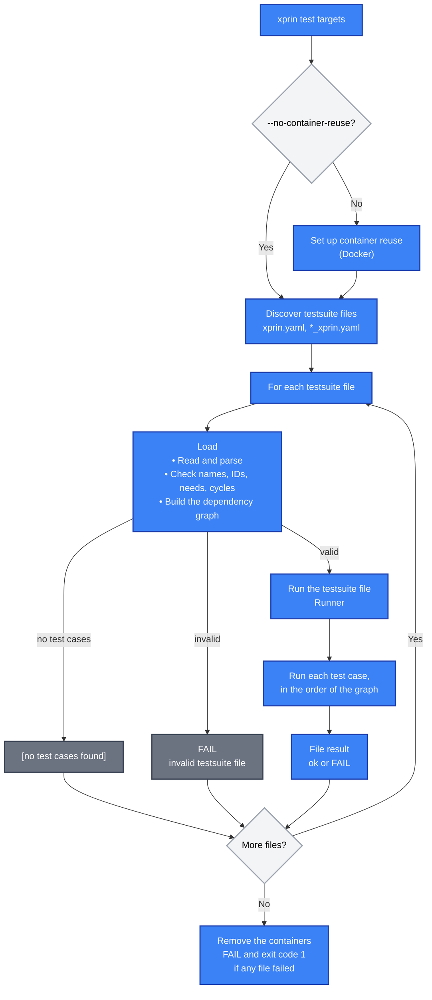
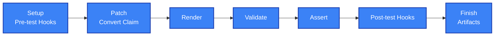

# Architecture

This document describes what xprin does under the hood: how a `xprin test` run goes from the targets you pass to the exit code, how testsuite files are found and loaded, how their test cases are ordered and run, and where files, containers and results go along the way. It names the packages behind each step, so that you can find the code. For what xprin does from a user's point of view, see [How It Works](how-it-works.md).

## Packages

| Package | What it does |
|---|---|
| `cmd/xprin` | The commands: `test`, `update-goldens`, `graph`, `check`, `config`, `version` |
| `cmd/xprin-helpers` | The helper commands `convert-claim-to-xr` and `patch-xr`, whose packages the runner also uses as libraries |
| `internal/config` | Loads the configuration (dependencies, repositories, custom subcommands) and checks it (`xprin check`) |
| `internal/xpcli` | Detects the Crossplane CLI and its capability tier (v1, v2legacy, v2), which decides the flags passed to render and validate |
| `internal/discovery` | Resolves the targets to testsuite files (`Walk`), and loads and checks them (`Load`) |
| `internal/api` | The types of a testsuite file |
| `internal/testsuite` | A loaded testsuite file: its path, its spec and its dependency graph |
| `internal/graph` | The dependency graph of the test cases of a file |
| `internal/testexecution/options` | The options of a run: configuration, flags, the Crossplane CLI tier, and the container coordinator |
| `internal/testexecution/processor` | Ties the pieces of a run together: containers, discovery, loading and the runner |
| `internal/testexecution/runner` | Runs the test cases of one file: phases, hooks, assertions, artifacts, and the mode of the command |
| `internal/testexecution/containers` | Reuse of the function containers across a run |
| `internal/templates` | Go templates, and the placeholders that let a testsuite file with templates be valid YAML |
| `internal/engine` | Results (test case, testsuite file), statuses and their output |

## The `xprin test` Command

A run goes through these steps, in this order:

1. **The command** (`cmd/xprin/test`) checks that the `--show-*` flags come with `-v`, sets the colors, builds the options from the configuration and the flags (dependencies, repositories, the Crossplane CLI tier), and gives the targets to the processor.
2. **The processor** (`processor.ProcessTargets`) first sets up the container reuse for the whole invocation (unless `--no-container-reuse`, see [Container Reuse](#container-reuse)), and removes the containers when it exits. It then hands the targets to discovery.
3. **Discovery** (`discovery.Walk`) resolves each target: a file (used only when it is named `xprin.yaml` or `*_xprin.yaml`), a directory (the files in it), or `dir/...` (every directory below). A target that doesn't exist is skipped, and no files at all prints `[no testsuite files]`. It calls the processor back for each file, goes on when one fails, and ends with `FAIL` and exit code 1 if any did.
4. **Loading** (`discovery.Load`) reads and checks each file: the `{{ ... }}` of templates are replaced by placeholders so that a file with unquoted templates is valid YAML (see [Templates](#templates)), the YAML is parsed into the spec, and a file without test cases prints `[no test cases found]` and ends there. `testsuite.New` then builds the [dependency graph](#the-dependency-graph), and the file is checked: empty names, duplicate IDs, a `needs` to an ID that doesn't exist, and cycles. All the problems of a file are reported together, and the file is `[invalid testsuite file]`.
5. **The runner** is made for the loaded file. `RunTests` makes the directory of the [internal artifacts](#artifacts), and creates the directory of the external ones once per invocation (with `--artifacts-dir`). It then runs the test cases in the order of the graph, prints the result of each as soon as it ends, and prints the line of the file.
6. **The exit code** is 1 when any file failed to load or any test case failed.

The other commands share the first steps: `xprin update-goldens` is the same flow with another mode of the runner (see [Modes](#modes)), and `xprin graph` stops after loading and prints the graph.

The detailed flow

## The Dependency Graph

`testsuite.New` builds the graph with `graph.Build(spec)`, from the `needs` of the test cases and nothing else (the templates are not read). It has a `Node` for each test case, by its position in the file, that knows:

- `Needs` and `NeededBy`: the test cases it lists in `needs`, and the ones that list it.
- `NeedsIndirectly` and `NeededByIndirectly`: the ones reached only through others (the graph follows the edges, and subtracts the direct ones).
- `HasGoldens` and `NeededForGoldens`: it has golden-file assertions, or a test case that has them needs it, directly or not.

`GetOrder` is a topological sort: each test case runs after the ones it needs, and when several can run, the one listed first in the file does. The order depends only on the file and the dependencies, never on the order of the IDs in a `needs`, and a file without dependencies runs as it is written.

`CheckCycles` runs the same sort, and what can't run is stuck: in a cycle, or waiting behind one. It follows the stuck test cases until it reaches one it has seen, which is a cycle, reports it (`needs cycle: a -> b -> a`), leaves it out and sorts again, until nothing is stuck. When it finds none, it keeps the order for `GetOrder`.

Who uses it:

- The loader rejects the file when `CheckCycles` finds any.
- The runner follows `GetOrder`, and skips a test case when the results of the test cases it needs show that one failed or was skipped.
- `update-goldens` reads `NeededForGoldens` to know what has to run.
- `xprin graph` prints it as a tree (`internal/graph/render`).

## Test Case Execution

For each test case, the runner does the following, in this order:

1. The mode may skip it (see [Modes](#modes)). Then the results of the test cases it needs are collected, and it is skipped if one failed or was skipped.
2. A temp directory `xprin-testcase-*` is made, with `inputs/` and `outputs/`. It is removed when the test case ends, after the external artifacts are exported (the defers run last in, first out).
3. The `common` configuration is merged, the template variables are processed (see [Templates](#templates)), and the mandatory fields are checked.
4. The phases run: the input paths are made absolute and checked, the inputs are copied (and the [container reuse](#container-reuse) is applied to the copy of the functions), the pre-test hooks run, and the render step converts the Claim or takes the XR, patches it, runs `crossplane render` and writes the rendered resources to `outputs/`.
5. The mode runs what follows the render.

Each phase returns the failed result to end the test case, or nil to go on. The exceptions are validation, assertions and post-test hooks: a failure in them is in the result, and the test case goes on to the next phase, so that the post-test hooks run even when assertions failed; the test case then fails at the end.

The detailed flow

```mermaid
flowchart TD
    S{"Needs a test case that<br/>failed or was skipped?"}
    S -->|Yes| U["SKIP"]
    S -->|No| A["Start Test Case<br/>• Expand inputs<br/>• Check paths<br/>• Copy inputs to tmp dir"]
    A --> B["Pre-test Hooks<br/>• Setup environment<br/>• Patch inputs<br/>• Pre-validate inputs"]
    B --> C{"Claim input?"}
    C -->|Yes| D["Convert Claim to XR<br/>claimtoxr package"]
    C -->|No| E["Use XR directly"]
    D --> F{"Patch XR?"}
    E --> F
    F -->|Yes| G["Patch XR (patchxr package)<br/>• Apply XRD defaults<br/>• Add connection secret"]
    F -->|No| I["crossplane render"]
    G --> I
    I --> J{"CRDs provided?"}
    J -->|Yes| K["crossplane resource validate"]
    J -->|No| L["Assertions (xprin / diff / dyff)<br/>• Count, existence, fields<br/>• Golden-file diff"]
    K --> L
    L --> M["Post-test Hooks<br/>• Cleanup<br/>• Validate outputs"]
    M --> N{"Test case has ID?"}
    N -->|Yes| O["Save Internal Artifacts"]
    N -->|No| Q{"--artifacts-dir?"}
    O --> Q
    Q -->|Yes| R["Export External Artifacts"]
    Q -->|No| P["End Test Case"]
    R --> P

    %% Color scheme: Group related operations with white text for readability
    classDef xprin fill:#3b82f6,stroke:#1e40af,stroke-width:2px,color:#fff
    classDef xprinHelpers fill:#f97316,stroke:#c2410c,stroke-width:2px,color:#fff
    classDef crossplane fill:#a855f7,stroke:#7e22ce,stroke-width:2px,color:#fff
    classDef validation fill:#10b981,stroke:#047857,stroke-width:2px,color:#fff
    classDef neutral fill:#6b7280,stroke:#374151,stroke-width:2px,color:#fff
    classDef decision fill:#f3f4f6,stroke:#9ca3af,stroke-width:2px,color:#000

    class A,B,M,O,R,P xprin
    class D,G xprinHelpers
    class I,K crossplane
    class L validation
    class E,U neutral
    class C,F,J,N,Q,S decision
```

### Modes

What differs between the commands that run the test cases is the `runnerMode` of the runner, set once per file; everything from the temp directory to the render is shared.

- `testMode` (`xprin test`) skips nothing. After the render it validates, runs the assertions and the post-test hooks, saves the outputs, and completes the result.
- `updateGoldensMode` (`xprin update-goldens`) skips a test case that has no golden-file assertions and that no test case with them needs (`NeededForGoldens`). After the render it writes the golden files, and saves the outputs for the test cases that need this one. A golden file that can't be written fails the test case, and the entries after it are not tried.

### Results

A test case ends as `PASS`, `FAIL`, `SKIP` or `ERROR` (`internal/engine`, `Status`), with the phases and the sections it collected: hooks, render, validate, assertions, and any other, such as `Golden Files`. Each result is printed as soon as the test case ends, and the testsuite result prints the line of the file (`ok` or `FAIL`) at the end.

The results are kept in memory, in the `TestSuiteResult` of the file, and the runner uses them while the file runs: they are looked up by ID, for the `needs` check and to fill `.Tests`. Nothing persists them, so a report in another format would be a new output of `internal/engine`.

The engine also formats them for the terminal. The render output is the tree of the rendered resources (`Kind/name`) when it succeeded, and the raw output, indented, when it failed; the hooks, the validation and the assertions each get a section with the mark of the status of each item. The engine also decides what is shown: without `-v` it hides the passes and the skips that have no reason.

### Assertions

The runner runs the three kinds of assertions of a test case in this order: `xprin`, `diff`, then `dyff`. They all read the files that the render wrote to `outputs/`: the `xprin` assertions index the rendered resources by `Kind/name`, and the golden-file ones compare the file in `expected` with the full render, or with the rendered file of `resource`. Their results are aggregated and formatted together, and the raw output is written to `outputs/assertions.txt` (which is what `.Outputs.Assertions` points to). An assertion that can't be evaluated, for example a `resource` that is not in the render, is an `ERROR` (`[!]`) and the others still run.

## Artifacts

There are two kinds, and they are not the same files:

- **Internal artifacts** are the outputs of a test case that has an `id`, kept for the test cases that need it. `RunTests` makes a temp directory for the testsuite file (`xprin-internal-artifacts-*`) and removes it when the file ends. The runner copies the `outputs/` of the test case to `<directory>/<test-id>/`, and points its `Outputs` there, so that `.Tests.<id>.Outputs.*` still works after the temp directory of the test case is removed.
- **External artifacts** are the inputs and the outputs of every test case, for you to inspect (`--artifacts-dir`, `xprin test` only). The runner makes `<dir>/xprin-artifacts-<timestamp>/` once per invocation, shared by the runners of all the files, and copies the `inputs/` and `outputs/` of a test case to `<run>/<directory of the file relative to the working directory>/<file name without extension>/<NN_name>/` (with the segments sanitized; a file outside the working directory falls back to its absolute path); it is deferred, so it also runs when a phase failed, and its errors are warnings on stderr. After each testsuite file, the path is printed to stderr (`artifacts: <path>`).

## External Tools

All the external commands go through one place in the runner: the process runs with the directory of the testsuite file as its working directory, and its stdout and stderr are captured together.

- **Crossplane CLI:** `crossplane render` and `crossplane resource validate` (`crossplane beta validate` on older CLIs), found through the dependencies of the configuration. The CLI changes between versions, see [Crossplane CLI Tiers](#crossplane-cli-tiers).
- **Hooks:** each hook is rendered, then run as `sh -c "<command>"`.
- **Helpers:** the Claim conversion and the XR patching are not run as the `xprin-helpers` binary: the runner calls the `claimtoxr` and `patchxr` packages in the same process.
- **Docker:** xprin doesn't run the function containers: `crossplane render` does. xprin only names them (see [Container Reuse](#container-reuse)), and removes them and the shared network through the Docker API.

### Crossplane CLI Tiers

`xpcli.Detect` probes the binary when the configuration is loaded, and the result is a tier (`internal/xpcli`):

- It runs `render --help`: no `--xrd` in it means v1. Then `resource validate --help`: if it fails, it is v2 before 2.3 (`v2legacy`), and otherwise v2.3 or later (`v2`). The version string, from `version --client`, is only for display. Nothing depends on a version number, so custom and nightly builds are classified by what they can do.
- The tier fixes the capabilities, and the runner reads them where it builds the commands (the render step for the render flags, the validate phase for the subcommand):

  | | v1 | v2legacy (2.0 - 2.2) | v2 (2.3+) |
  |---|---|---|---|
  | `SupportsRenderXRD`: `--xrd` for render | no | yes | yes |
  | `SupportsRenderVersion`: `--crossplane-version` for render, and the shared network of the container reuse | no | no | yes |
  | `DefaultValidateSubcommand` | `beta validate` | `beta validate` | `resource validate` |

- An explicit `subcommands` in the configuration wins over the default of the tier.

What changed in v2.3, which xprin accounts for:
- The CLI was split from Crossplane core. Its commands are grouped by the noun they act on, the `alpha` and `beta` prefixes are gone, and the maturity of a command is in its help: `beta validate` became `resource validate`.
- `crossplane render` starts a Crossplane controller container and a Docker network for each call. `--crossplane-version` sets the version of the controller image, and the runner uses it in two places. The render step passes it as is, as `--crossplane-version=<version>`, only when `SupportsRenderVersion` (v2.3+); on the other tiers it is skipped, and `--debug` says so. The validate phase passes it on every tier, as `--crossplane-image=xpkg.crossplane.io/crossplane/crossplane:<version>`, built from the version; it only matters for a test case that has CRDs, as validate is skipped without them.

How `patches.xrd` is applied depends on the tier. On v1, render has no `--xrd`, so the patching step applies the XRD defaults (the `patchxr` package). On v2legacy and v2 the Go patch for the XRD is skipped, and `--xrd` is passed to render, which applies them and reads the XRD's `spec.scope`: without it, render treats an XRD as the Modern scope and puts `resourceRefs` at `spec.crossplane.resourceRefs` instead of `spec.resourceRefs` for a LegacyCluster XRD. The Claim conversion gets the XRD too (`claimtoxr.Options.XRD`), and takes the XR's kind from `spec.names.kind` instead of guessing "X" plus the kind of the Claim.

## Templates

A testsuite file can use Go templates anywhere, which are not valid YAML when unquoted (`xr: {{ .Repositories.x }}/xr.yaml`). So `Load` replaces them with placeholders (`internal/templates/placeholder`) before parsing, and the runner restores them when it renders.

The runner renders a test case like this: it marshals it without its hooks, restores the placeholders, executes the template with `.Repositories`, `.Inputs` and `.Tests` (the results of the test cases it needs), and unmarshals the result back. The hooks are rendered when they run, so that a post-test hook can also use `.Outputs`. A template that uses `.Tests` for a test case that exists but is not in `needs` fails with a message that says so.

## Container Reuse

Composition functions run in Docker containers. Starting one for every `crossplane render` is slow, so xprin reuses them across the test cases and files of an invocation:

1. `ProcessTargets` makes a `Coordinator` for the invocation, with a random run ID.
2. For each test case, the runner calls `containers.ApplyReuse` on the copy of its functions (a file or a directory of YAML files). For each `Function` it reads `spec.package`, the image, and adds two annotations unless the user set them: `render.crossplane.io/runtime-docker-name`, with the container name, and `render.crossplane.io/runtime-docker-cleanup: Orphan`, which leaves the container running after the render, for the next one.
3. The container name is `xprin-<run ID>-<first 12 characters of the SHA-256 of the image>`. The same image gives the same name in the whole invocation, and different images give different names, even when the functions have the same `metadata.name`. The first render that uses a name pulls the image if it isn't local (the default pull policy of render is `IfNotPresent`) and starts the container, and the following ones find it already running.
4. Render would put each call's containers on a new Docker network, and leave a reused one unreachable. So the first render asks the coordinator for the shared network `xprin-net-<run ID>` and passes it with `--crossplane-docker-network` (Crossplane CLI v2.3.0 and later).
5. When the invocation ends, `RemoveAll` removes the containers it recorded and the network. If xprin is killed, they stay, and the names tell whose they are.

What it saves is measured in [#165](https://github.com/crossplane-contrib/xprin/pull/165): on the examples of this repository (22 testsuite files, Crossplane CLI v2.5.0) the function containers went from 90 to 2, the networks from 45 to 1, and the run from about 72s to about 35s. The Docker work itself is small (about 65ms from create to start and 80ms from kill to destroy); the rest is the network that every render call made, and waiting for a fresh function to accept connections. The Crossplane controller container that render starts on CLI v2.3+ can't be reused, so it costs the same either way.

---

**Next Steps:**
- Learn about helper utilities in [xprin-helpers](xprin-helpers.md)
