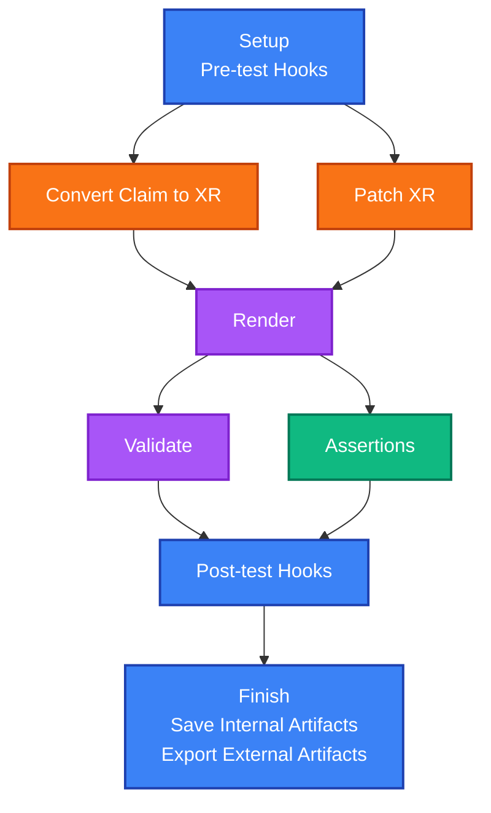
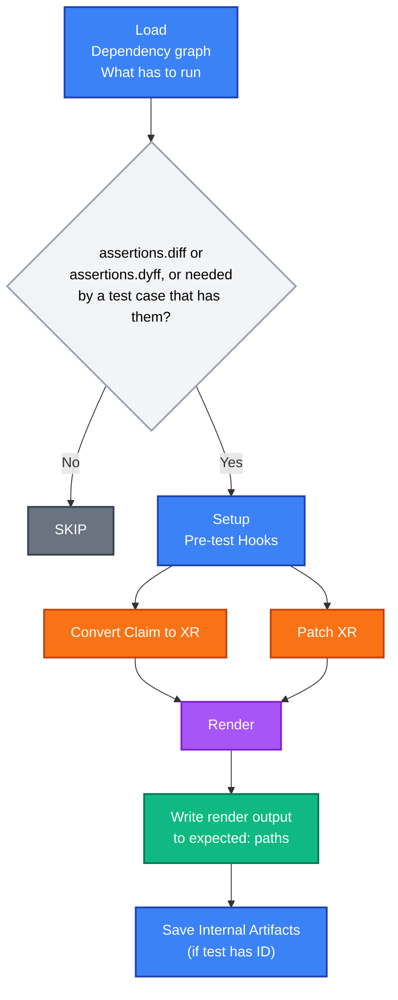

# How It Works

This document describes how xprin behaves, step by step: how a testsuite file is loaded, what each phase of a test case does, how errors are reported, and how test cases depend on each other. For the flow diagrams and the components behind them, see [Architecture](architecture.md).

## Discovering Testsuite Files

`xprin test` takes one or more targets: files, directories, or `dir/...` for a directory and everything below it. It discovers the files named `xprin.yaml` or `*_xprin.yaml` among them, and loads and runs them one by one, each with its own result line.

## Loading a Testsuite File

Before any test case of a file runs, xprin loads it once:

1. The file is read and checked: a test case needs a name, IDs are unique, and every ID in `needs` belongs to a test case of the file.
2. The [dependency graph](#dependency-graph) is built from the `needs` of the test cases, and checked for cycles. A file with a problem is reported with all its problems, and none of its test cases runs.
3. The graph gives the order in which the test cases run: every test case after the ones it needs, whatever the order of the file.

The test cases then run one after another in that order (currently xprin doesn't run test cases in parallel). One that needs a test case that failed or was skipped is skipped (see [Dependencies Between Test Cases](#dependencies-between-test-cases-needs)); the others go through the phases below.

## Phase-by-Phase Breakdown

Each test case goes through a series of sequential phases:



**Phase Overview:**
1. **Setup** - Expand inputs, resolve paths, copy to temp directory
  - Execute Pre-test hooks for further environment setup
2. **Patch**
  - Custom patching via Pre-test Hooks
  - Convert Claim to XR (if needed)
  - Apply XRD defaults and connection secrets to XRs
3. **Render** - Execute `crossplane render` to generate manifests
4. **Validate** - Execute `crossplane resource validate` (if CRDs provided)
5. **Assert** - Run declarative Assertions on rendered resources
6. **Post-test Hooks** - Execute the Post-test Hooks
7. **Finish**
  - Save internal artifacts (if test has ID)
  - Export external artifacts (if `--artifacts-dir` is set)

The [template variables](#available-variables) you can use, and where, are listed in [Template Variable Expansion](#template-variable-expansion).

### Phase 1: Setup

**What happens:**
1. **Input Expansion**: Template variables (e.g., `{{ .Repositories.myrepo }}`) are expanded using Go templates
2. **Path Resolution**: All input paths are resolved (absolute, relative to test suite file, or template-based), and checked for existence
3. **Temp Directory**: The input files are copied to a temporary directory made for the test case (inputs are never modified in place)
4. **Pre-test Hooks**: All pre-test hooks are executed sequentially (they can modify the copied files)

**Template Variables:** see [Available Variables](#available-variables).

**Key Points:**
- All operations happen in an isolated temp directory
- Input files are never modified in their original location
- Pre-test hooks can modify files in the temp directory
- If any pre-test hook fails, the test fails immediately

### Phase 2: Patch (Optional)

**What happens:**
1. **Claim to XR Conversion** (if using Claim input): If a Claim is provided instead of an XR, it is converted to an XR, the way [`xprin-helpers convert-claim-to-xr`](xprin-helpers/convert-claim-to-xr.md) does. The converted XR is written to the temp directory and used for subsequent phases.
   - If the test case also sets `patches.xrd`, it's passed through to this step: the XR's kind is resolved from the XRD's `spec.names.kind` instead of guessed as "X" prefixed to the Claim's kind, since that's only a naming convention, not a guarantee.
   - If the test case also has a full-render `assertions.diff`/`assertions.dyff` entry (an `expected:` golden file with no `resource:` set), that golden file is passed through as `--golden`: a matching document's name is reused instead of a fresh random suffix, making the Claim-derived XR - and anything a Composition derives from its name - reproducible across runs (see [convert-claim-to-xr.md](xprin-helpers/convert-claim-to-xr.md)).
2. **XRD Defaults**: If `xrd` path is provided in `patches`, apply the XRD defaults to the XR
3. **Connection Secret**: If `connection-secret: true`, set the `spec.writeConnectionSecretToRef` field in the XR, with a configurable name and namespace (does not create the secret itself, just configures where Crossplane should write it)

The patched XR replaces the original in the temp directory (see [`xprin-helpers patch-xr`](xprin-helpers/patch-xr.md)).

**Alternative Patching via Pre-test Hooks:**
- Pre-test hooks (executed in Phase 1) can also be used for patching XR, Composition, or other input files
- Pre-test hooks operate on the copied files in the temp directory, allowing you to modify them before the formal patching phase
- This is useful for advanced patching scenarios that go beyond XRD defaults and connection secrets
- If both pre-test hook patching and `patches` configuration are used, pre-test hooks run first (in Phase 1), followed by the formal patching phase (Phase 2)

**When it runs:**
- The Claim conversion only runs with a Claim input
- The patching only runs if a `patches` section is defined (in `common` or test case level), and test case level patches override common patches
- Without either, this phase is skipped

### Phase 3: Render

**What happens:**
1. **Command Execution**: Runs `crossplane render` with:
   - XR (or patched XR) from temp directory
   - Composition file
   - Functions directory
   - Optional context files, context values, observed resources, extra resources, function credentials
2. **Output Capture**: The rendered manifests are written to the temp directory, and split into one file per resource

**Output Files** (available to post-test hooks, see [Available Variables](#available-variables)):
- `{{ .Outputs.Render }}` - Full rendered output (all resources in one file)
- `{{ .Outputs.Rendered "Kind/name" }}` - Individual resource files (one per resource)

**Error Handling:**
- If `crossplane render` fails, the test fails **immediately**
- No subsequent phases (validate, assertions, post-test hooks) are executed
- This is a hard failure because without rendered output, nothing else can proceed

**CLI versions:** when a test case sets `patches.xrd`, xprin passes it to render as `--xrd` on the CLIs that support it (see [Crossplane CLI Versions](#crossplane-cli-versions)).

**Function container reuse:** the function containers are reused across test cases, and kept running after each render. See [Function Container Reuse](#function-container-reuse), and `--no-container-reuse` to disable it.

### Phase 4: Validate (Optional)

**What happens:**
1. **Command Execution**: If `crds` are provided in inputs, runs `crossplane resource validate` (or `crossplane beta validate` on legacy CLIs) with the rendered output from Phase 3 and the CRD paths
2. **Output Capture**: The validation results are written to a file, and parsed to determine success or failure

**Output Files:**
- `{{ .Outputs.Validate }}` - Raw Validate output file

**Error Handling:**
- If `crossplane resource validate` fails, the test **continues** to assertions and post-test hooks
- Validation failures are collected and reported at the end
- This allows assertions to run even if validation fails, enabling better debugging

**CLI versions:** the validate subcommand depends on the CLI, and can be set in the configuration (see [Crossplane CLI Versions](#crossplane-cli-versions)).

**When it runs:**
- Only if `crds` are provided in inputs
- If no CRDs are provided, this phase is skipped and execution proceeds directly to assertions

### Phase 5: Assert

**What happens:**
1. **Assertion Execution**: All assertions are executed sequentially, each against the rendered resources
2. **Result Collection**: All assertion results (pass/fail) are collected

**Assertion engines:** xprin supports three engines (the types, the `resource` patterns and the field paths are in [Assertions](assertions.md)):
- **xprin**: Count, existence, field type/value checks on rendered resources
- **diff**: Golden-file comparison using unified diff (line-by-line)
- **dyff**: Golden-file comparison using structural YAML diff (document-aware)

**Error Handling:**
- All assertions are evaluated even if some fail
- Failed assertions are collected and reported at the end
- If assertions fail, the test **continues** to post-test hooks
- This allows cleanup and additional validation even when assertions fail

**Output Files:**
- `{{ .Outputs.Assertions }}` - Assertions output path

### Phase 6: Post-test Hooks (Optional)

**What happens:** All post-test hooks are executed sequentially, after the assertions (see [Hooks Execution](#hooks-execution)).

**Template Variables:** see [Available Variables](#available-variables).

**Error Handling:**
- Post-test hooks run even if validation or assertions failed, so that cleanup can happen; they don't run after a hard failure (setup or render, see [Error Handling Behavior](#error-handling-behavior))
- Hook failures are collected and reported

**When it runs:**
- Only if post-test hooks are defined (in `common` or test case level)

### Phase 7: Finish

**What happens:**
1. **Save Internal Artifacts** (if test has ID): The outputs are saved as internal artifacts, for the test cases that need it
2. **Export External Artifacts** (if `--artifacts-dir` is set): The inputs and the outputs of the test case are exported to a persistent directory
3. **Cleanup**: Temp directory is cleaned up

**Save Internal Artifacts:** only for a test case with an `id`. Its outputs are available to the test cases that list it in `needs`, via `.Tests.{test-id}.Outputs.*` (see [Test Chaining](#test-chaining) and [Artifacts](#artifacts)).

**Export External Artifacts:** only with `--artifacts-dir` (`xprin test` only), also when a phase failed, so that the failure can be inspected (see [Artifacts](#artifacts)).

## Error Handling Behavior

xprin follows a specific error handling strategy that balances immediate failure detection with comprehensive error collection:

### Hard Failures (Immediate Stop)

These failures cause the test to fail immediately, skipping all subsequent phases:

1. **Setup Phase Failures:**
   - Path expansion/verification failures
   - Pre-test hook failures
   - Claim to XR conversion failures

2. **Render Phase Failures:**
   - `crossplane render` command failures
   - Render output parsing failures

**Rationale:** Without successful setup or render output, subsequent phases cannot proceed meaningfully.

### Soft Failures (Continue Execution)

These failures are collected and reported, but execution continues:

1. **Validate Phase Failures:**
   - `crossplane resource validate` command failures
   - Schema validation errors

2. **Assert Phase Failures:**
   - Failed assertions (count, existence, field checks)

**Rationale:** Continuing execution allows:
- Assertions to run even when validation fails (better debugging)
- Post-test hooks to run for cleanup
- All errors to be collected and reported together

### Error Collection and Reporting

- All errors are collected throughout execution
- Errors are reported at the end of test execution
- `xprin test` ends with `FAIL` and exit code 1 when any test case fails or any testsuite file can't be loaded
- Verbose mode (`-v`) shows detailed error messages
- Debug mode (`--debug`) shows even more detail

## Statuses and output symbols

xprin uses a small set of **statuses** and **symbols** in its output, aligned with `crossplane resource validate` so that **[✓]**, **[x]**, and **[!]** mean the same thing across tools.

### Symbols and status values

Output uses the following **symbols**; internally, outcomes use the corresponding **status** value:

| Symbol | Status | Internal value | Meaning |
|--------|--------|----------------|--------|
| **[✓]** | Pass | `PASS` | Check ran and passed. |
| **[x]** | Fail | `FAIL` | Check ran and the condition was false (e.g. assertion failed, hook exited non-zero). |
| **[!]** | Error | `ERROR` | Check could not run (e.g. missing resource, invalid config, render failure, hook template error). |
| **[s]** | Skip | `SKIP` | Skipped: in `update-goldens` mode, the test case has no `assertions.diff`/`assertions.dyff` entries and no test case that has them needs it (directly or not), or a test case it [`needs`](#dependencies-between-test-cases-needs) failed or was skipped. |

### Verbose vs non-verbose output

By default (non-verbose), only **FAIL** results are printed. Adding `-v`/`--verbose` we see all results including PASS and SKIP. A test case skipped because of the test cases it `needs` is always shown (even without `-v`), with the reasons.

In `update-goldens` mode, test cases that write golden files are always shown (even without `-v`), so we can confirm which files were written.

### Where they appear

- **Preliminary / test-level errors** (missing mandatory fields, failed to create dirs, etc.): each line of the error block is prefixed with **[!]**.
- **Render failure**: the first line of the raw render output is prefixed with **[!]**; continuation lines are indented under it.
- **Validate**: output is passed through from `crossplane resource validate`, which already uses **[✓]**, **[x]**, and **[!]**.
- **Hooks**: **[✓]** for success; **[x]** when the hook process exited with a non-zero code; **[!]** when the hook could not run (e.g. template rendering failure).
- **Assertions**: **[✓]** when the assertion ran and passed; **[x]** when it ran and the condition was false; **[!]** when it could not be evaluated (e.g. resource not found, invalid assertion config). The totals line reports successful, failed, and error counts.

Individual phases (render, validate, hooks, assertions) and each check within them use all of these statuses. The **overall test case**, however, has only **Pass** or **Fail**. So if there is a preliminary error ([!]), a render failure, or any operational error, the test case is still reported as **Fail** (e.g. `--- FAIL: Test name (X.XXXs)`), not as a separate "Error" outcome.

## Common vs Test-Level Configuration

xprin supports defining configuration at two levels: `common` (shared across all tests) and test case level (specific to a test).

### Merging Logic

1. **Common Configuration**: Applied to all test cases in the suite
2. **Test Case Configuration**: Overrides common configuration for that specific test
3. **Field-Level Replacement**: For all fields (including maps like `inputs.context-files`, `inputs.context-values`), if a test case specifies a field, it completely replaces the common value for that field. There is no deep merging of map keys - the entire field value is replaced.
4. **List replacement (per type)**: For **hooks** and **assertions**, merge is per type. For hooks: `hooks.pre-test` and `hooks.post-test` are independent—if the test case has no pre-test hooks, common’s pre-test hooks are used; if it has any, the test case’s list is used (and similarly for post-test). For assertions: same per engine (`assertions.xprin`, `assertions.diff`, `assertions.dyff`)—if the test case has no assertions for a given engine, common’s list for that engine is used; if it has any, the test case’s list is used. There is no appending; each list is replaced as a whole when the test case specifies it.

### Precedence Rules

- Test case level **always** overrides common level
- If a test case specifies a field (even if it's a map), the entire field value is replaced (not merged)
- For maps like `context-files` and `context-values`, if the test case map is empty, common values are used; if the test case map has any keys, it completely replaces the common map
- For hooks and assertions, each list type is merged independently: empty test case list for that type uses common’s; non-empty uses the test case’s list.

### Example

```yaml
common:
  inputs:
    functions: /common/functions
    crds:
    - /common/crds
  hooks:
    pre-test:
    - name: "common setup"
      run: "echo 'common'"
  assertions:
    xprin:
    - name: "common-count"
      type: "Count"
      value: 3

tests:
- name: "Test 1"
  inputs:
    functions: /test1/functions  # Overrides common
    # crds not specified, so common crds are used
  hooks:
    pre-test:
    - name: "test1 setup"
      run: "echo 'test1'"  # Replaces common hook (doesn't append)
  # assertions not specified, so common assertions are used
- name: "Test 2"
  inputs:
    functions: /test2/functions
  assertions:
    xprin:
    - name: "test2-count"
      type: "Count"
      value: 5  # Replaces common assertions (doesn't append)
```

## Template Variable Expansion

Template variables use Go's `text/template` package for dynamic content.

### Expansion Timing

- **Input Expansion**: Happens during setup phase, before file copying
- **Hook Expansion**: Happens when hooks are executed (pre-test or post-test)

### Available Variables

| Variable | Description | Where it can be used |
|---|---|---|
| `{{ .Repositories.name }}` | Path of a repository from the configuration | Input fields and hooks |
| `{{ .Inputs.XR }}` | XR file path (not in pre-test hooks with a Claim input: the conversion comes after) | Hooks |
| `{{ .Inputs.Claim }}` | Claim file path (with a Claim input) | Hooks |
| `{{ .Inputs.Composition }}` | Composition file path | Hooks |
| `{{ .Inputs.Functions }}` | Functions file or directory path | Hooks |
| `{{ .Inputs.CRDs }}` | List of CRD file paths | Hooks |
| `{{ .Inputs.ContextFiles }}` | Map of context keys to file paths | Hooks |
| `{{ .Inputs.ContextValues }}` | Map of context keys to inline values | Hooks |
| `{{ .Inputs.ObservedResources }}` | Observed resources file path | Hooks |
| `{{ .Inputs.ExtraResources }}` | Extra resources file path | Hooks |
| `{{ .Inputs.FunctionCredentials }}` | Function credentials file path | Hooks |
| `{{ .Tests.<id>.Outputs.* }}` | Outputs of a test case listed in `needs`, which must have an `id` and have completed (see [Test Chaining](#test-chaining)) | Input fields and hooks |
| `{{ .Outputs.XR }}` | XR file path | Post-test hooks only |
| `{{ .Outputs.Render }}` | Full rendered output path | Post-test hooks only |
| `{{ index .Outputs.Rendered "Kind/Name" }}` | Path of an individual rendered resource | Post-test hooks only |
| `{{ .Outputs.RenderCount }}` | Number of rendered resources | Post-test hooks only |
| `{{ .Outputs.Validate }}` | Validation output path, if validation ran | Post-test hooks only |
| `{{ .Outputs.Assertions }}` | Assertions output path (`assertions.txt`), if assertions ran | Post-test hooks only |

Everything can be used in post-test hooks. `.Inputs` points to the copies of the inputs in the temp directory, so it is for hooks, and `.Outputs` exists only after the render, so only post-test hooks can use it.

### Template Functions

Standard Go template functions are available:
- `{{ index .Map "key" }}` - Access map values
- `{{ .Field | default "value" }}` - Default values
- String manipulation functions, etc.

## Path Resolution

xprin supports three types of paths for input fields:

### 1. Absolute Paths

```yaml
inputs:
  composition: /absolute/path/to/composition.yaml
```

- Used as-is, no resolution needed
- Must exist at test execution time

### 2. Relative Paths

```yaml
inputs:
  composition: relative/path/to/composition.yaml
```

- Resolved relative to the test suite file location
- Example: If test suite is at `/repo/tests/suite_xprin.yaml` and input is `comp.yaml`, resolved to `/repo/tests/comp.yaml`

### 3. Template-Based Paths

```yaml
inputs:
  functions: {{ .Repositories.myrepo }}/functions
```

- Template is expanded first, then resolved as absolute or relative
- Repository paths from configuration are absolute
- Can combine templates with relative paths: `{{ .Repositories.myrepo }}/relative/path`

## Test Chaining

Test cases can depend on each other, enabling sequential workflows and reconciliation testing. A test case declares the test cases it depends on in `needs`, and can then also use their outputs. `xprin graph` shows these dependencies (see [Dependency Graph](#dependency-graph)).

### Dependencies Between Test Cases: `needs`

A test case that depends on other test cases lists their IDs in `needs`, as jobs do in GitHub Actions. It doesn't have to use their outputs: the test case runs after them, and only if they passed.

```yaml
tests:
- name: "Create the database"
  id: db
  inputs:
    xr: db/xr.yaml
    composition: db/composition.yaml
    functions: functions.yaml

- name: "Create the app, which only makes sense once the database works"
  needs:
  - db
  inputs:
    xr: app/xr.yaml
    composition: app/composition.yaml
    functions: functions.yaml
```

- `needs` is a list of IDs of test cases of the same file, listed before or after it, so only a test case with an `id` can be needed. An ID that doesn't exist makes the file invalid, and so does an empty list (`needs: []`): list the IDs, or remove it.
- Test cases run in the order of their dependencies: each one after the test cases it needs. When several can run, the one listed first in the file does, so the order only depends on the file and its dependencies (never on the order of the IDs in a `needs`), and a file without dependencies runs in the order it is written. The results are printed in that order, and `xprin graph` shows the same dependencies.
- Test cases can't need each other, directly or not, nor themselves: that makes the file invalid too, and the error names each cycle (`needs cycle: a -> b -> a`: a needs b, which needs a).
- If a test case it needs failed or was skipped, the test case is **not run**: it is skipped (**SKIP**), and the reasons are printed under it, one per needed test case, even without `-v`:

  ```text
  --- SKIP: Create the app, which only makes sense once the database works (0.00s)
      [!] needs failed test case "db"
  ```

  A test case that needs none of the failed ones runs as usual.

  The skip propagates: a test case that needs a skipped one is skipped too. Before `needs`, a test case that used the outputs of a failed one failed with a confusing template error; now only the test case that really failed is reported as a failure. See [Example 2](../examples/README.md#example-2-when-a-test-case-fails-the-ones-that-need-it-are-skipped).

### Using the Outputs of Other Test Cases

A test case that depends on another one can also use its outputs, with the `.Tests` template variable:

```yaml
tests:
- name: "Base layer"
  id: base
  inputs:
    xr: base/xr.yaml
    composition: base/composition.yaml
    functions: functions.yaml

- name: "Layer on top of the base"
  needs:
  - base
  inputs:
    xr: '{{ .Tests.base.Outputs.XR }}'
    composition: top/composition.yaml
    functions: functions.yaml
```

A test case can only use (`.Tests.<id>`) the outputs of the test cases it lists in `needs`. Using another one fails the test case, with an error that says it has to be listed.

#### How It Works

1. **Test ID**: The test case that is used must have an `id` field
2. **Internal Artifacts**: After test completes, its outputs are saved as internal artifacts (see [Artifacts](#artifacts))
3. **Cross-test References**: The test cases that list it in `needs` can reference its outputs via `.Tests.{test-id}.Outputs.*`
4. **Cleanup**: The internal artifacts are removed when the testsuite file finishes

#### Use Cases

- **Reconciliation Workflows**: Use XR output from one composition as input to another
- **Sequential Dependencies**: Chain tests where each depends on previous outputs
- **Cross-test Validation**: Compare outputs between different scenarios

#### Limitations

- Tests must run sequentially (not in parallel)
- Referenced test must complete before reference is valid
- If the referenced test fails, the test cases that need it are skipped, so they never see missing outputs

### Migrating from Automatic Detection (Deprecated)

Until xprin 0.5 there was no `needs`: a test case that used `.Tests.<id>` depended on that test case automatically, because xprin read the templates to find out. **This is deprecated**, and it is removed in 0.7.0: a test case that uses the outputs of another one has to list it in `needs`. Not listing it gets in the way of running test cases at the same time predictably.

| xprin | Dependencies between test cases |
|---|---|
| up to 0.5 | Detected automatically, by reading the templates for `.Tests`. `needs` is not supported. |
| 0.6 | Both are supported, per testsuite file (see below). Detecting them automatically is **deprecated**: xprin prints a warning for each testsuite file that relies on it. |
| 0.7.0 and later | Only `needs` is supported. |

**In 0.6 each testsuite file is in one of two formats**, decided when it is loaded:

- **Legacy**: no test case lists `needs`, and some use `.Tests`. They run as they always did, one after another, in file order, each seeing all the earlier ones, and xprin prints a warning for the file. The warning appears for any use of `.Tests`, also one that can't work (for example a typo in the ID: the test case then fails when it runs).
- **Current**: every other file, which means one where at least one test case lists `needs` (migrated), or one that doesn't use `.Tests` at all. There is no warning, a test case only sees the test cases it lists, and the ones whose needs failed are skipped, as described above.

**Migrating.** In each test case that uses `.Tests.<id>`, list those IDs in `needs`. Once one test case in a file lists `needs`, every test case in it has to list what it uses. `xprin-helpers check-testsuite-needs <targets>` finds what is missing in every test case of the files and shows it, so that you can add it (see [check-testsuite-needs](xprin-helpers/check-testsuite-needs.md)).

## Hooks Execution

Hooks provide a way to execute arbitrary shell commands at specific points in the test execution.

### Execution Environment

- **Working Directory**: The directory of the testsuite file. The copies of the inputs, and the outputs, in the temp directory of the test case are reached through `{{ .Inputs.* }}` and `{{ .Outputs.* }}`
- **Environment Variables**: Inherited from parent process
- **Template Expansion**: Hook commands are expanded with template variables before execution
- **Sequential Execution**: Hooks run one after another, in order

### Pre-test Hooks

**When:** Before Claim conversion and XR patching

**Use Cases:**
- Environment setup
- Input validation
- Advanced input patching (modifying XR, Composition, or other input files)
- Dependency preparation

**Important:** Pre-test hooks operate on the **copied files in the temporary directory**, not the original files. This means:
- You can safely modify input files (XR, Composition, etc.) without affecting the originals
- Template variables like `{{ .Inputs.XR }}` point to the copied files in the temp directory
- Any modifications made in pre-test hooks will be used in subsequent phases (render, validate, etc.)
- The original files in your repository remain unchanged

**Available Variables:** see [Available Variables](#available-variables).

**Error Handling:**
- If any pre-test hook fails (non-zero exit), test fails immediately
- Subsequent hooks are not executed

### Post-test Hooks

**When:** After assertions, before the internal artifacts are saved

**Use Cases:**
- Cleanup operations
- Output validation
- Comparison with previous tests
- External tool integration (Kyverno, UpTest, etc.)

**Available Variables:** see [Available Variables](#available-variables).

**Error Handling:**
- Post-test hooks run even if validation or assertions failed, so that cleanup can happen
- Hook failures are collected and reported, and a failed post-test hook fails the test case

## Assertions Execution

Assertions run after validation (or after rendering, when there are no CRDs), on the rendered resources in the temp directory. Three engines are supported: **xprin** (in-process count/existence/field checks), **diff** (golden-file unified diff, [go-difflib](https://github.com/pmezard/go-difflib)) and **dyff** (golden-file structural YAML diff, [dyff](https://github.com/homeport/dyff)). They are all evaluated, even when some fail, and reported together; the test case then continues to the post-test hooks.

See [Assertions](assertions.md) for the engines, the types, the [field path syntax](assertions.md#field-path-syntax), the [execution and error handling](assertions.md#execution-and-error-handling), and examples.

## update-goldens Execution Flow

`xprin update-goldens` shares the same pipeline as `xprin test` through Render, then diverges: instead of validating or asserting, it writes the render output to the `expected:` paths of `assertions.diff` and `assertions.dyff` entries.



**Test cases without `assertions.diff`/`assertions.dyff`** are reported as **SKIP** immediately. This avoids unnecessary work for test cases that have nothing to write. The exception is a test case that a test case with golden assertions [needs](#dependencies-between-test-cases-needs), directly or through others: it runs as the others do, and writes nothing, so that the test cases that use its outputs (`.Tests`) have them, and can write their golden files. A test case that is needed only by test cases that are skipped is skipped too: no golden file depends on it. The [dependency graph](#dependency-graph) knows which ones those are.

**Phases that run** for test cases with golden assertions, and for the ones they need (identical to `xprin test`): Setup, Pre-test Hooks, Convert Claim to XR, Patch XR, Render.

**Phases that are skipped**: Validate, Assert, Post-test Hooks. The outputs of a test case with an `id` are still saved as internal artifacts, as in `xprin test`, for the test cases that need it.

**After Render**, for each `assertions.diff` and `assertions.dyff` entry, the render output (full render, or filtered to a single resource when `resource:` is set) is written to the `expected:` path. The `Golden Files:` section of the output lists them, one `[✓] <assertion name>: <path>` line per entry written (the name tells the entries apart when a `diff` and a `dyff` entry write the same file). If one can't be written (for example, a `resource:` that is not in the render output), a `[!] <assertion name>: <path>: <reason>` line follows the ones written, the test case fails, and the entries after it are not tried.

**Pre-test hooks run** for test cases that have golden assertions, for the same reason they run in test mode: they may modify the XR or other inputs before render, so skipping them would produce different render output than `xprin test` would see.

## Dependency Graph

`xprin graph <targets>` shows which test cases of each testsuite file need which others, the dependency graph, without running anything. It takes the same targets as `xprin test` (files, directories, and `...` for recursive directories), and needs no configuration.

```
➜ xprin graph examples/mytests/5_chained_tests/example5_xprin.yaml
examples/mytests/5_chained_tests/example5_xprin.yaml
└── Base layer final loop [base_final]
    ├── GCP layer first loop [gcp_first]
    │   └── GCP layer second loop [gcp_second]
    │       └── GCP layer third loop
    └── AWS layer first loop [aws_first]
        └── AWS layer second loop [aws_second]
            └── AWS layer third loop
```

### Reading the Tree

- Test cases at the top level need no other test case.
- A test case listed under another one needs it. Test cases listed side by side (siblings) don't need each other.
- A test case that needs several others is listed under each of them: it is expanded the first time, and marked `(*)` afterwards.
- The ID of a test case, if it has one, is shown in brackets.

### How Dependencies Are Found

The graph is made of the [`needs`](#dependencies-between-test-cases-needs) of the test cases, and nothing else: xprin doesn't read the templates for it.

- A testsuite file that doesn't use `needs` has no dependencies to show, so all its test cases are at the top level. If it uses `.Tests` anyway, it relies on the deprecated automatic detection, whose dependencies are not shown: list them in `needs` to see them (see [Migrating](#migrating-from-automatic-detection-deprecated)).
- Dependencies that are not declared in `needs` are not shown, for example a hook that relies on files or state left behind by another test case.

## Artifacts

xprin keeps files for two purposes, and calls them internal and external artifacts.

- **Internal artifacts** are the outputs of a test case that has an `id`, saved so that the test cases that list it in `needs` can use them (`.Tests.<id>.Outputs.*`). They are temporary, removed when the testsuite file finishes, and you don't need to look at them.
- **External artifacts** are for you to inspect a run: with `--artifacts-dir <dir>`, xprin exports the inputs and the outputs of every test case to `<dir>/xprin-artifacts-<timestamp>/`, also for the test cases that failed. After each testsuite file it prints the path (`artifacts: <path>`) to stderr.

```
➜ xprin test tests/... --artifacts-dir /tmp/xprin-debug
...
artifacts: /tmp/xprin-debug/xprin-artifacts-20260101120000/tests/aws_xprin

➜ find /tmp/xprin-debug -maxdepth 4
/tmp/xprin-debug/xprin-artifacts-20260101120000/tests/aws_xprin/01_first_loop/inputs
/tmp/xprin-debug/xprin-artifacts-20260101120000/tests/aws_xprin/01_first_loop/outputs
/tmp/xprin-debug/xprin-artifacts-20260101120000/tests/aws_xprin/02_second_loop/inputs
...
```

The directory of a testsuite file mirrors its path from where you ran xprin, without the extension, and there is one directory per test case, numbered in the order they ran. A skipped test case has nothing to export.

xprin doesn't save the results of a run. The result of each test case is kept in memory while its testsuite file runs, and printed as soon as the test case ends; the line of the file is printed at the end. To keep the files of a run, use `--artifacts-dir`: `assertions.txt`, in the outputs of a test case, has the results of its assertions.

## Function Container Reuse

By default, `xprin test` reuses one Docker container per unique composition function image for the entire invocation, instead of starting and tearing down a container for every single `crossplane render` call.

**Only function containers are reused.** With Crossplane CLI v2.3+, `crossplane render` also starts a Crossplane controller container on every call. That one can't be reused: `crossplane render` has no option to name, keep or reuse it, so it is started and removed by render itself for every test case, with or without `--no-container-reuse`.

**How it works:**
1. For each test case, xprin reads the `Function` resources in its functions file(s), and adds two annotations to the copy in the temp directory: `render.crossplane.io/runtime-docker-name`, which names the container after its image, and `render.crossplane.io/runtime-docker-cleanup: Orphan`, which keeps it running after the render. If you set either one yourself, xprin leaves yours alone.
2. The first test case in the run that uses an image pays for it: the image is pulled if it isn't on the machine yet (with or without reuse), and the container is started, so this test case is slower. Every later one that uses the same image reuses the running container, in the same or another testsuite file: there is nothing to start, and the function is already warm.
3. With Crossplane CLI v2.3+, xprin also passes one shared Docker network to every render call, so that a reused container stays reachable.
4. All the containers (and the network) are removed once, when `xprin test` finishes, whether it succeeded or failed.

**What it saves:** on this repository's own examples (22 testsuite files), a run took 72s without reuse and 35s with it, and created 2 function containers instead of 90.

**Why this is safe:** Crossplane composition functions are stateless by contract. In a real cluster, the same function container already serves many unrelated reconciles over its lifetime without restarting. Reusing a container across test cases relies on the same guarantee.

**Disabling it:** pass `--no-container-reuse` (to `xprin test` or `xprin update-goldens`) to fall back to a fresh container per render call, matching the pre-reuse behavior. You might want this if you suspect a function under test isn't actually stateless, or to rule out container reuse while debugging an unrelated issue.

**A known edge case:** if `xprin test` is killed abruptly (e.g. `SIGKILL`, out-of-memory), the cleanup step doesn't run and a container (and the shared network) can be left behind. Their names start with `xprin-`, and they are safe to remove manually (`docker rm -f`, `docker network rm`).

## Crossplane CLI Versions

xprin runs the `crossplane` binary of your [configuration](configuration.md) as a command, and adapts to its version: v1, v2, and v2.3 and later, where some commands were renamed (`crossplane resource validate` instead of `crossplane beta validate`). It detects what the binary supports when it starts, and `xprin check` shows the result. You can also set the render and validate commands yourself in `subcommands`, which always wins over the detection, so a CLI that xprin doesn't know yet still works (see [Configuration](configuration.md#subcommands)).

`--crossplane-version` selects the version of the Crossplane controller image. It is used by validate on every CLI version (as `--crossplane-image`, when a test case has CRDs), but by render only with Crossplane CLI v2.3.0 and later (as `--crossplane-version`): older CLIs ignore it for render.

---

**Next Steps:**
- See what happens under the hood in [Architecture](architecture.md)
